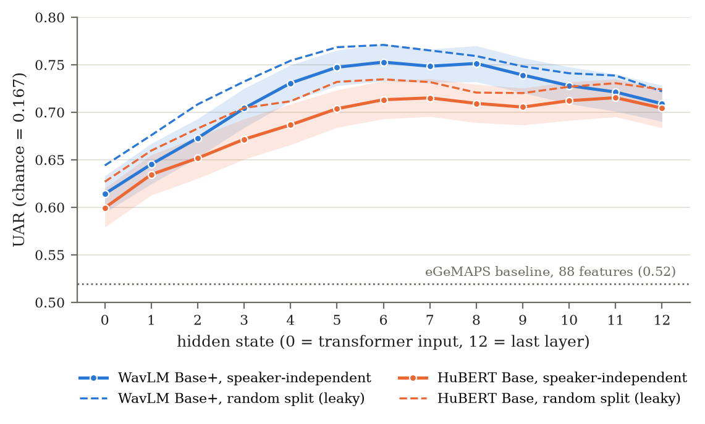
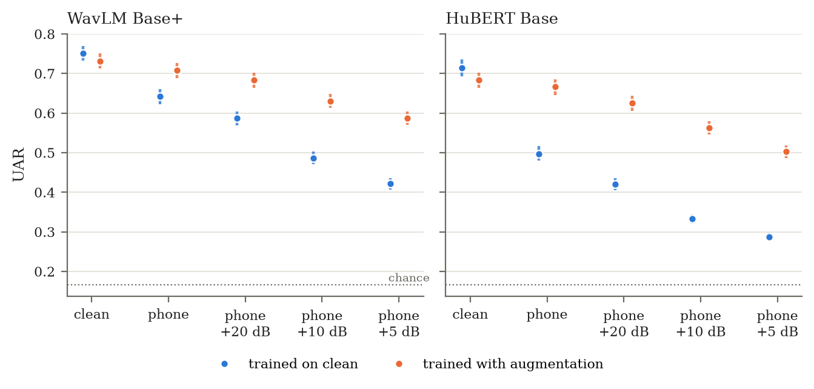
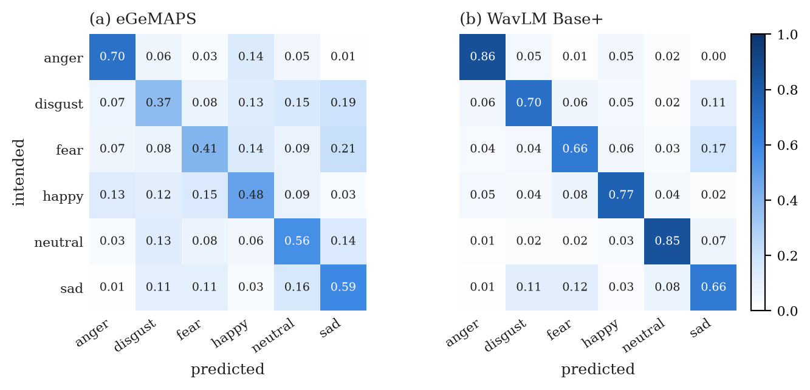
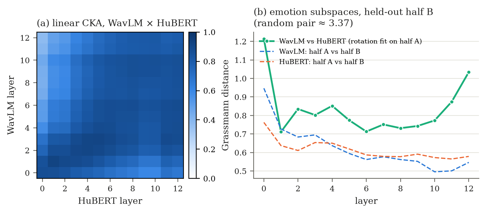

# speech-affect-lab

Speech emotion recognition with frozen self-supervised encoders (WavLM Base+, HuBERT Base)
and a linear classifier. The project checks how much emotion such an encoder exposes on
speakers it has never seen, how much survives a simulated telephone line with noise, what ONNX
export, layer truncation and int8 quantisation give on a CPU, and how the two encoders
organise emotion geometrically (CKA, Procrustes, Grassmann distances, Fisher-LDA).

The full write-up is in [report/report.pdf](report/report.pdf) (11 pages).

| | |
|---|---|
|  |  |

## Main findings

1. On speakers never seen in training, a frozen WavLM with logistic regression reaches a UAR
   of 0.75 (chance 0.17). That is 23 pp more than the eGeMAPS features evaluated with the same
   protocol, and 3.7 pp more than HuBERT.
2. Emotion is easiest to read out in the middle layers. For WavLM the curve peaks at layers
   5 to 8, the inner cross-validation picked layer 6 or 7 in every fold, and the last layer is
   worse.
3. Speaker leakage is real but small for a linear classifier (1.6 to 2.0 pp), since strong
   regularisation keeps it from memorising voices. Speaker-disjoint splits are still needed.
4. The telephone channel is the biggest problem. Band limiting and μ-law alone cost 11 pp with
   WavLM and 22 pp with HuBERT; with noise at 5 dB, a third of the quality or more is lost.
   Training the classifier on augmented audio brings back 7 to 17 pp and costs 2 pp on clean
   audio.
5. On this CPU, truncation helps more than quantisation. Cutting the encoder after layer 7
   gives 1.35x with no loss in quality. Dynamic int8 gives only 1.15x and misses both
   pre-registered criteria, because the convolutional front-end, about half of the run time,
   stays in fp32. ONNX, truncation and int8 together: 1.8x faster, and 82 MB instead of
   361 MB.
6. Both encoders put the emotion class means in nearly the same subspace: after a Procrustes
   rotation, the Grassmann distance between them is close to the split-half noise level and far
   from random. WavLM is better because of the shape of the scatter around the means. The
   Fisher-LDA criterion follows the layer-wise UAR (r = 0.92 for WavLM, 0.97 for HuBERT); the
   Euclidean between/within ratio does not.

The success criteria were written down before the experiments were run
([docs/PREREGISTRATION.md](docs/PREREGISTRATION.md)). Two of them, both about int8, are not met,
and the tables say so.

## Results

The tables below are generated from the run logs by `experiments/make_report.py`.

<!-- RESULTS -->
### Success criteria (pre-registered in docs/PREREGISTRATION.md)

| Stage | Criterion | Value | Verdict |
|---|---|---|---|
| 1 | Speaker-independent UAR: lower bound of the 95% interval > chance (1/6) | 0.733 > 0.167 | met |
| 1 | Leakage: lower bound of the paired interval (random - speaker) > 0 | +0.7 pp | met |
| 2 | Drop under telephone conditions reported with a paired interval | see the stage 2 table | met |
| 2 | Augmentation: lower bound of the paired B - A interval > 0 on every telephone condition | min lower bound +5.3 pp | met |
| 3 | ONNX = PyTorch: max abs difference <= 1e-04 | 3.1e-06 | met |
| 3 | int8: lower bound of the paired interval UAR(int8) - UAR(fp32) >= -1 pp | -1.26 pp | **not met** |
| 3 | int8: p50 latency lower by at least 1.5x | 1.15x | **not met** |
| extra | WavLM beats eGeMAPS: lower bound of the paired difference interval > 0 | +21.8 pp | met |

### 1. Emotion on clean audio (CREMA-D, 6 classes, chance = 0.167)

Run: `outputs/exp01_emotion_probe/20261116-135910`. UAR with a 95% speaker-bootstrap interval; differences by paired bootstrap, in percentage points (pp).

| Encoder | UAR, speaker-independent | UAR, random split | Leakage (random - speaker), pp | Layer chosen per fold |
|---|---|---|---|---|
| WavLM Base+ | 0.751 [0.733, 0.770] | 0.768 [0.751, 0.784] | +1.6 [+0.7, +2.5] | 6, 6, 7, 7, 7 |
| HuBERT Base | 0.714 [0.693, 0.736] | 0.735 [0.717, 0.752] | +2.0 [+0.8, +3.2] | 6, 7, 11, 11, 11 |

WavLM - HuBERT (paired): +3.7 [+2.5, +4.9] pp.

**Slices (WavLM, speaker-independent split):**

| Slice | UAR |
|---|---|
| female speakers | 0.769 [0.740, 0.794] |
| male speakers | 0.735 [0.706, 0.761] |
| female - male, pp | +3.4 [-0.5, +7.1] |
| intensity LO (sentence IEO) | 0.670 [0.629, 0.712] |
| intensity MD (sentence IEO) | 0.721 [0.684, 0.758] |
| intensity HI (sentence IEO) | 0.752 [0.716, 0.787] |
| listener majority vs intended emotion (6798 clips without a tie) | 0.461 [0.438, 0.487] |
| model vs intended emotion (same clips) | 0.754 [0.736, 0.774] |
| model vs listener majority | 0.604 [0.585, 0.623] |


### 2. Telephone channel and noise

Run: `outputs/exp02_telephone/20261116-145504`. A: probe trained on clean audio; B: trained on augmented audio (telephone and noise from a separate train pool of noise files).

**WavLM Base+**

| Test condition | A: trained on clean | Drop in A (clean - condition), pp | B: with augmentation | Gain B - A, pp |
|---|---|---|---|---|
| clean | 0.751 [0.733, 0.770] | - | 0.731 [0.712, 0.750] | -2.0 [-2.9, -1.0] |
| telephone | 0.642 [0.623, 0.661] | +10.9 [+9.4, +12.4] | 0.708 [0.689, 0.727] | +6.6 [+5.3, +8.0] |
| telephone + noise at 20 dB SNR | 0.587 [0.568, 0.604] | +16.4 [+15.2, +17.7] | 0.683 [0.664, 0.701] | +9.7 [+8.5, +10.9] |
| telephone + noise at 10 dB SNR | 0.487 [0.470, 0.502] | +26.4 [+24.8, +28.1] | 0.631 [0.613, 0.648] | +14.4 [+12.9, +15.8] |
| telephone + noise at 5 dB SNR | 0.422 [0.407, 0.436] | +32.9 [+31.4, +34.5] | 0.587 [0.570, 0.605] | +16.5 [+15.1, +17.9] |

Best layer by condition (A): clean: 6, telephone: 7, telephone + noise at 20 dB SNR: 7, telephone + noise at 10 dB SNR: 7, telephone + noise at 5 dB SNR: 7.

**HuBERT Base**

| Test condition | A: trained on clean | Drop in A (clean - condition), pp | B: with augmentation | Gain B - A, pp |
|---|---|---|---|---|
| clean | 0.714 [0.693, 0.736] | - | 0.683 [0.663, 0.703] | -3.1 [-4.2, -2.1] |
| telephone | 0.497 [0.480, 0.516] | +21.7 [+19.8, +23.7] | 0.666 [0.646, 0.686] | +16.9 [+15.1, +18.7] |
| telephone + noise at 20 dB SNR | 0.420 [0.405, 0.435] | +29.4 [+27.5, +31.4] | 0.625 [0.605, 0.643] | +20.5 [+18.7, +22.2] |
| telephone + noise at 10 dB SNR | 0.333 [0.321, 0.344] | +38.2 [+36.2, +40.3] | 0.562 [0.545, 0.579] | +23.0 [+21.4, +24.4] |
| telephone + noise at 5 dB SNR | 0.287 [0.276, 0.298] | +42.8 [+40.8, +44.8] | 0.502 [0.487, 0.518] | +21.6 [+20.0, +23.1] |

Best layer by condition (A): clean: 11, telephone: 10, telephone + noise at 20 dB SNR: 10, telephone + noise at 10 dB SNR: 9, telephone + noise at 5 dB SNR: 9.


### 3. Compression for CPU

Run: `outputs/exp03_compression/20261116-152348`. WavLM Base+ truncated to 7 layers. 3 s clip, ONNX Runtime on CPU, p50/p95 over 200 runs after 20 warm-up runs.

| Variant | Size, MB | p50 / p95, ms (1 thread) | p50 / p95, ms (4 threads) |
|---|---|---|---|
| PyTorch, 12 layers, fp32 | - | 795 / 801 | 266 / 351 |
| ONNX, 12 layers, fp32 | 361 | 689 / 699 | 210 / 230 |
| ONNX, 12 layers, int8 | 116 | 575 / 581 | 171 / 196 |
| ONNX, 7 layers, fp32 | 226 | 510 / 515 | 165 / 197 |
| ONNX, 7 layers, int8 | 82 | 445 / 447 | 142 / 208 |

- int8 vs fp32 speed-up (truncated model, p50): 1.15x (1 thread), 1.17x (4 threads).
- 7 vs 12 layers (fp32, p50): 1.35x (1 thread), 1.27x (4 threads).
- Combined (PyTorch 12 layers fp32 -> ONNX 7 layers int8): 1.79x (1 thread), 1.88x (4 threads).
- ONNX fp32 vs PyTorch equivalence: max abs difference 3.1e-06 (12 layers), 1.3e-06 (7 layers) on 20 clips; threshold 1e-04.
- Quality on all clips (CPU, out-of-fold): fp32 0.749 [0.732, 0.767], int8 0.742 [0.724, 0.759]; int8 - fp32 -0.7 [-1.3, -0.1] pp; predictions agree on 93.1% of clips; fp32/int8 embedding cosine mean 0.992, min 0.934.
- CPU: Intel64 Family 6 Model 165 Stepping 2, GenuineIntel.

**Where the CPU time goes** (exploratory, not pre-registered; ONNX Runtime profiler, 1 thread, `outputs/exp03b_profile/20261116-161704`):

| Model | Share of time by operator type |
|---|---|
| wavlm_full_fp32 | MatMul 45%, Conv 36%, Gemm 4%, SkipLayerNormalization 4% |
| wavlm_full_int8 | Conv 43%, DynamicQuantizeMatMul 30%, MatMulIntegerToFloat 10%, Gelu 5% |
| wavlm_trunc_fp32 | Conv 47%, MatMul 35%, Gelu 4%, Gemm 3% |
| wavlm_trunc_int8 | Conv 55%, DynamicQuantizeMatMul 22%, MatMulIntegerToFloat 7%, Gelu 5% |

### 4. Baseline: classic eGeMAPS features

Run: `outputs/exp04_egemaps_baseline/20261116-174622`. 88 openSMILE features, the same logistic regression, the same nested speaker-independent validation, the same folds.

| Features | UAR, speaker-independent |
|---|---|
| eGeMAPS (88) | 0.520 [0.501, 0.539] |
| HuBERT Base, linear probe | 0.714 [0.693, 0.736] |
| WavLM Base+, linear probe | 0.751 [0.733, 0.770] |

WavLM - eGeMAPS (paired): +23.2 [+21.8, +24.6] pp. Per-class recall (eGeMAPS -> WavLM): ANG 0.70 -> 0.86, DIS 0.37 -> 0.70, FEA 0.41 -> 0.66, HAP 0.48 -> 0.77, NEU 0.56 -> 0.85, SAD 0.59 -> 0.66.



### 5. Exploratory: WavLM vs HuBERT representations

Run: `outputs/exp05_representations/20261119-162307`. No pre-registered criteria.

- Linear CKA between corresponding layers: 0.80-0.92.
- Grassmann distance between the 5-dimensional emotion class-mean subspaces, layers 4-9 (rotation fit on one half of the actors, compared on the other): WavLM vs HuBERT 0.71-0.85; the same model on the two halves 0.55-0.64; random subspaces 3.37.


<!-- /RESULTS -->

## Method in brief

- **Data:** CREMA-D — 7,442 clips, 91 actors (48 m / 43 f), 6 acted emotions, 12 fixed
  sentences, 16 kHz; every file verified against its official SHA-256. Target = the emotion the
  actor intended. See [docs/DATA.md](docs/DATA.md).
- **Features:** frozen `microsoft/wavlm-base-plus` and `facebook/hubert-base-ls960` (pinned
  revisions); each of the 13 hidden states is mean-pooled over time.
- **Classifier:** `StandardScaler` + logistic regression.
- **Validation:** 5 outer folds `StratifiedGroupKFold` (groups = speakers); an inner 3-fold
  grouped loop on the training speakers picks the layer and `C`. Primary metric UAR; 95%
  bootstrap intervals over speakers; paired bootstrap for comparisons on the same clips. A
  deliberately leaky random split measures speaker leakage.
- **Telephone channel:** 300–3400 Hz band-pass → 8 kHz → 8-bit μ-law → 16 kHz, MUSAN noise at
  20 / 10 / 5 dB SNR; disjoint noise pools for augmentation and testing.
- **CPU:** encoder truncated after the chosen layer + mean pooling → ONNX (dynamo) → ONNX Runtime
  dynamic int8; latency on an Intel i7-10850H (AVX2, no VNNI), 3 s clip, 1 and 4 threads.

## Repository layout

```
src/speech_affect/
  config.py            single source of truth: paths, seeds, model ids, CV settings (pydantic, frozen)
  runs.py              one folder per run: outputs/<experiment>/<timestamp>/ + meta.json (git commit, config)
  experiment.py        shared experiment setup (labels, aligned embeddings, bootstrappers)
  data/                CREMA-D download with hash verification, manifest, speaker-grouped folds
  features/            encoder loading, hidden-state extraction and caching, eGeMAPS (openSMILE)
  models/probe.py      nested layer-and-C selection for the linear probe
  channel/             telephone channel and noise mixing (MUSAN), deterministic per clip
  evaluation/          metrics from confusion matrices, speaker / paired bootstrap, plots
  export/              ONNX export, int8 quantisation, latency benchmark
  analysis/            coordinate-free representation comparison (CKA, Procrustes, Grassmann, Fisher)
experiments/           exp01 … exp05, make_report.py (README tables), make_figures.py (report figures)
report/                report.tex, refs.bib, figures/, compiled report.pdf
docs/                  DATA.md (sources, licences, verified numbers), PREREGISTRATION.md
tests/                 unit tests (fast by default); data/model tests behind markers
```

## Reproduce

Requires Python 3.12 and [uv](https://docs.astral.sh/uv/). A CUDA GPU makes feature extraction
fast (~4 min per model and condition) but is not required.

```bash
uv sync
uv run python -m speech_affect.data.cremad download      # ~0.6 GB, hash-verified
uv run python -m speech_affect.data.cremad manifest
uv run python -m speech_affect.channel.noise download    # MUSAN noise/, ~0.6 GB
uv run python -m speech_affect.features.extract --model wavlm --condition clean
# … for each model in {wavlm, hubert} and condition in {clean, tel, tel_snr20, tel_snr10, tel_snr5, aug_train}
uv run python experiments/exp01_emotion_probe.py
uv run python experiments/exp02_telephone.py
uv run python experiments/exp03_compression.py --model wavlm
uv run python experiments/exp03b_profile.py
uv sync --extra egemaps && uv run python -m speech_affect.features.egemaps
uv run python experiments/exp04_egemaps_baseline.py
uv run python experiments/exp05_representations.py
uv run python experiments/make_figures.py && uv run python experiments/make_report.py
uv run pytest                                            # fast unit tests
```

The report is built with LuaLaTeX (required by the `florilegium` package that draws the title page):
`cd report && lualatex report && bibtex report && lualatex report && lualatex report`.

No audio, embeddings or model files are stored in the repository (`data/` and `outputs/` are
git-ignored).

## Caveats

- Acted emotions are not real calls. Actors read 12 fixed sentences with often exaggerated
  portrayals in a studio. The numbers compare methods; they are not clinical accuracy.
- The labels are noisy. The audio-only listener majority matches the intended emotion in only
  45.6% of the clips without a tied vote.
- The channel simulation is simplified: continuous μ-law instead of table-based G.711, no
  mobile codecs (AMR, Opus), packet loss or echo.
- Latency was measured on one laptop CPU; server CPUs with VNNI usually gain more from int8.
- Bootstrap intervals cover test-speaker variability, not training randomness.

## Licence

The code, documentation and report in this repository are released under the
[MIT licence](LICENSE).

The data are not part of the repository and keep their own licences: CREMA-D is under the Open
Database License 1.0 and the Database Contents License 1.0, and MUSAN under CC BY 4.0 with
per-file licences for the noise recordings (details in [docs/DATA.md](docs/DATA.md)). The
pretrained WavLM and HuBERT checkpoints are downloaded from Hugging Face and are covered by the
licences published with them. If you use the data, please cite the original papers listed in
the report.
